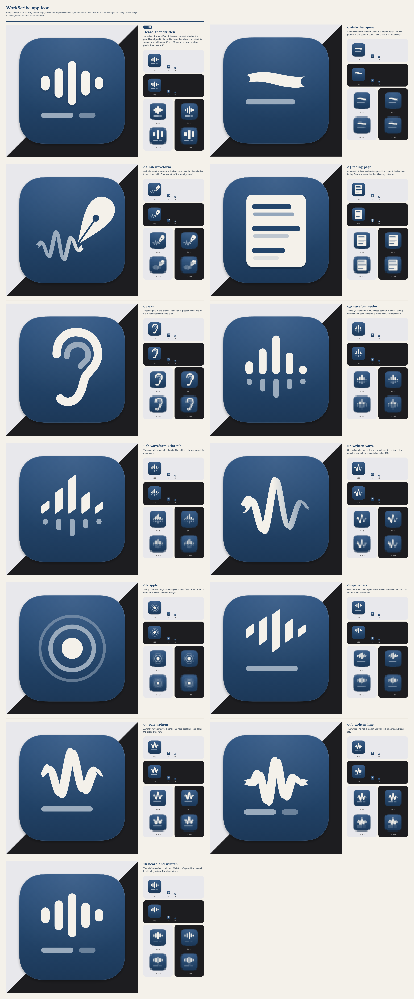

# WorkScribe app icon: "Heard, then written"

## The concept

The tally's five-bar waveform, drawn in cream ink on the Indigo Wash. Under it is a single pencil line, shorter and lighter, written the way WorkScribe writes under your lines. The line is left-aligned to the ink rather than centred, as the AI line is aligned to your text. Its second word is still drying.

From across the room it's the waveform you already know from the menu bar. Up close, it's the whole product: something was heard, and a quieter line is being written beneath it.

## Why this one won

Twelve drawings are in `concepts/`, and all of them are on the contact sheet at 1024, 128, 32 and 16 px on light and dark Docks.

- **It carries the idea at every size.** The ink-and-pencil pair (heavy cream over light pencil) still reads at 32 px. The concepts that put the idea in texture or gradient lost it by 128: the nib's drying trail (02) and the written wave that dries from ink to pencil (06).
- **It belongs to the tally without repeating it.** The bars keep the menu-bar glyph's rhythm (6, 12, 18, 10 and 4, lightly eased so the shortest bar stays a pill). The pencil line makes it a different drawing, so the app icon and the status item never look like two sizes of the same asset.
- **It's calm.** The written-wave concepts (06, 09, 09b) had the most personality, but the frayed stroke ends and nib contrast are exactly the "tiny detail" Liquid Glass flattens. The design README says every surface except the note should be "as quiet as it can bear". The icon follows that too.
- **What lost on meaning.** The page (03) reads well but could be any notes app. The ear (04) reads as a question mark. The ripple (07) reads as a record button. The echo (05) looks like a music visualiser's reflection.

## Details

- **Shape.** The body is the macOS continuous-corner square, 824 pt at (100, 100) on the 1024 pt canvas, with radius 0.2237 × side and a soft 10 pt drop shadow in the margin. That's the standard macOS icon grid.
- **Content area.** The mark spans 482 × 440 pt (58% × 53% of the body), and its centre sits 10 pt above the body's centre. Visually the group's weight is in the bars, so the optical centre falls a little higher still.
- **Weights.** The ink bars are 66 pt wide and 38 pt apart. The pencil line is 40 pt, about 0.6 × the ink, so it reads as a lighter voice and not as a second row of the same thing.
- **Depth.** The ink sits on a soft 32% shadow; the pencil has none. Pencil marks lie flat on the page, ink stands up a little. The wash darkens slightly from top to bottom, and the inside of the rim carries a faint light edge, so the icon keeps its outline on a dark Dock.
- **Liquid Glass.** macOS 26 still draws an `.icns`-only icon properly from 64 px up. At 32 px it shrinks the icon onto a grey tile, and it does this even though the shape is correct: Obsidian and Zed get the same tile. See `macos26-check.png`. So the build also ships `Assets.car`, compiled by `actool` from `AppIcon.icon`, an Icon Composer document with two layers. The ink layer is glass, because wet ink is glossy. The pencil layer is matte and casts almost no shadow, because graphite lies flat on the page. Neither layer is translucent. `CFBundleIconName` points macOS 26 at the catalog, and `CFBundleIconFile` keeps `AppIcon.icns` as the fallback.
- **Small sizes are redrawn, not shrunk.** `AppIcon-32.svg` puts five 2 px bars and a 2 px pencil line on whole pixels. `AppIcon-16.svg` uses three 2 px bars and a 1 px pencil line: at 16 px, five bars become grey fog. Corners at these sizes are 0.5 to 0.75 px, because a full round cap only adds a row of half-grey pixels to each end of a bar. The magnified columns on the contact sheet show the difference. One trade-off: on macOS 26, the system draws every size, including 16 and 32 px, from `Assets.car`'s layers. So these hand-fitted pixels only appear where the `.icns` is read directly (older tools, Quick Look of the `.icns`, anything that ignores asset catalogs).
- **Where it's seen.** WorkScribe is an `LSUIElement` app, so the Dock rarely shows it. The icon is seen most in notifications, in System Settings › Privacy & Security, and in Finder and Spotlight, mostly at 32 to 64 px. That's why the fitted small variants matter more here than for most apps.

## Palette

| Role | Hex | Notes |
| --- | --- | --- |
| Indigo (wash) | `#23456b` | The brand colour, at the wash's midpoint. The gradient runs `#2b5281` → `#23456b` → `#1c3858`, top to bottom |
| Cream (ink) | `#f4f1ea` | Brand cream. The bars lift very slightly to `#f8f6f0` at the top. Contrast on indigo is 8.7:1 |
| Pencil | `#9aabbd` | Cream laid over the indigo at about 58%, then cooled a touch, like graphite on blue paper. Contrast is 4.2:1. The drying word is drawn at 70% |
| Shadow | `#0b1a2c` at 32% | Under the ink only |

Indigo Wash appears only in the icon, onboarding and the website. Inside Obsidian, WorkScribe uses the theme's own tokens (see `design/care/README.md`).

## Files

| Path | What |
| --- | --- |
| `AppIcon.svg` | Master, 1024 pt |
| `AppIcon-32.svg`, `AppIcon-16.svg` | Pixel-fitted variants for 32 px (16@2x and 32@1x) and 16 px |
| `AppIcon.iconset/` | Every size, @1x and @2x, from 16 to 512@2x |
| `AppIcon.icns` | `iconutil -c icns AppIcon.iconset`. `scripts/build-app.sh` copies it into `Contents/Resources` and sets `CFBundleIconFile` |
| `AppIcon.icon/` | The same drawing as an Icon Composer document: a gradient fill, plus ink and pencil layers scaled to Icon Composer's full-bleed canvas. You can open it in Icon Composer |
| `Assets.car` | `AppIcon.icon` compiled by `actool`. It's committed, so building the app doesn't need Xcode |
| `macos26-check.png` | How macOS 26.5 draws the icon (`NSWorkspace.icon(forFile:)` on a probe bundle), with and without `Assets.car` |
| `concepts/` | Every concept SVG |
| `contact-sheet.png` | Everything above, at true pixel size |
| `tools/` | The generator. Run `python3 Resources/AppIcon/tools/build.py` to rebuild everything. It needs Google Chrome (as the SVG rasteriser), numpy and iconutil, plus Xcode 26 for `Assets.car`. `probe.swift` is the macOS check |

## Not verified

- The Dock's Dark, Clear and Tinted icon styles. `NSWorkspace` returned the default appearance even when asked for dark (Notes did the same), so those styles are macOS's automatic treatment of the two layers, and nobody has looked at them yet. The quickest check is to open `AppIcon.icon` in Icon Composer and switch its appearance previews.
- A real `scripts/build-app.sh` run. The script change is two `cp` lines and two plist keys, and `bash -n` passes. The probe bundle has the same layout (`Assets.car`, `AppIcon.icns`, both keys), but the full app build wasn't run, because it needs the Plaud and NeMo runtimes.
