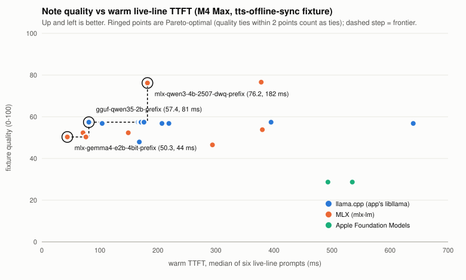

# Local LLM for WorkScribe's note jobs: prefill benchmark and speed vs quality frontier

> Historical measurements. The raw-prompt harness was retired in the core rebuild; use WorkScribe `--eval-notes`, `--eval-retrieval`, and `--measure-text-models` for current application behavior. Historical commands below require their original git revision.

*Measured 2026-10-16 to 10-17 on this Mac: Apple M4 Max (32-core GPU, 36 GB), macOS 26.5.1. Everything ran on device; no cloud model or cloud judge was used. The harness, raw results and every prompt and output are in [`scripts/bench-llm/`](../../scripts/bench-llm/README.md).*

## Summary

The goal was to speed up prefill without losing note quality, so the results below are a frontier of trade-offs, not a single winner. Quality is currently scored only on the `tts-offline-sync` fixture. The intelligence eval set (`fixtures/intel-eval`) was not ready when this was written; once it lands, its score replaces the fixture score (see [Pending](#pending-intelligence-eval-set)).



Three configs are Pareto-optimal. Two configs count as tied when their quality is within 2 points; one manual grade step on one line moves the score by about 1.4.

| config | fixture quality /100 | warm live-line TTFT | warm TTFT at ~2k tokens | what it costs |
|---|---|---|---|---|
| **Qwen3-4B-Instruct-2507 4-bit DWQ, MLX, resident, cached instruction prefix** | **76** | 182 ms | 1.36 s (4k: 3.4 s) | New runtime (mlx-swift-lm); 2.1 GB download; about 2.6 GB RSS / 4.7 GB peak footprint |
| Qwen 3.5 2B Q4_K_M (shipped model), app's llama.cpp, **resident + cached prefix** | 57 | 81 ms | 0.58 s (4k: 1.3 s) | No model change; restructure `CTextGeneration` only |
| Gemma 4 E2B 4-bit, MLX, resident + cached prefix | 50 | 44 ms | 0.25 s (4k: 0.56 s) | New runtime; 3.3 GB download; about 3.8 GB RSS / 4.5 GB footprint |

What these numbers mean for the app:

- **The shipped path wastes latency before any model choice.**
  - Loading the model on every call costs Qwen 3.5 2B about 225 ms per live line (395 → 170 ms) and Gemma about 420 ms (640 → 219 ms).
  - The first call in a fresh process, which pays load plus Metal kernel compilation, takes 1.0 s for Qwen and 2.3 s for Gemma.
  - Caching the fixed 270-token instruction halves what remains, to 81 ms.
  - Neither change alters a single output token.
- **Only one config buys a real step in quality.**
  - Qwen3-4B-2507 scores 76. Every other model, 2B to 4B, scores between 46 and 57.
  - Qwen3-4B-2507 is the only model that gets every final line right, scoring 19 of 19 facts, with no ungrounded numbers. It also leads on live lines: 17 of 19 facts, against 6 to 13 for the 2B models.
  - Even so, it fails `pricing?` abstention and still invents a link in about one line in five.
- **Apple Foundation Models is dominated.**
  - Prefill runs at about 1.1k tok/s.
  - The context window is 4,096 tokens, so 4k prompts do not fit.
  - Its first bullet is a bare title on every live line.
  - Its one advantage is that it is untouched by GPU load.
- **Nobody passes `pricing?`.**
  - The planner hands the live line four time-matched excerpts about other topics, and every model, 4B included, writes a "pricing" line from them.
  - This is a planner fix, not a model fix (see [Findings beyond the model](#findings-beyond-the-model)).

**Recommendation for now.** Ship residency and the prefix cache on the current llama.cpp path immediately. It is free, and its outputs are byte-identical to today's. For quality, move live and final lines to Qwen3-4B-2507 on MLX, at 182 ms per live line. Treat that move as provisional until the intel eval set confirms the quality gap; do not choose on speed alone. Gemma 4 E2B on MLX is the speed-first point. Its 4k prefill is 6× faster, but its line quality is the lowest of the frontier.

## Per job

| job | prompt (fixture) | recommendation | measured warm TTFT | quality on the fixture |
|---|---|---|---|---|
| **Live line** (one note, settled evidence) | 334–527 tokens, `NotePrompt.instruction`; the first 268 tokens are fixed rules | Qwen3-4B-2507 DWQ on MLX, resident, rules prefix cached | 182 ms (median of 6); 1k tokens: 0.53 s, 2k: 1.36 s | Facts in the shown line 17/19 (3/5 complete); manual 8/12 live points; `pricing?` fails |
| | | Interim, no new runtime: Qwen 3.5 2B GGUF, resident + prefix | 81 ms | Facts 13/19 (1/5 complete); literal "Topic" labels, extra bullets |
| **Final line** (after Stop, one `finalNote` per note) | 286–432 tokens | Qwen3-4B-2507 DWQ on MLX | TTFT 271 ms; whole line 0.69 s (median) | 19/19 facts, 5/5 complete, 0 ungrounded numbers; manual 9/10 |
| **Brief** (proposed prompt, the whole short meeting) | 414 tokens | Qwen3-4B-2507, written from the **final lines** rather than raw transcript (not measured; see below) | TTFT 317 ms; whole brief 1.5 s | 9/10 facts, but two conflations, e.g. "Prototype … by Monday, November 4" |
| **Also discussed** (`NotePrompt.topics`) | 335 tokens | Same model as final lines | about 300 ms | Not scored. The fixture has no uncovered topics, and every model re-summarised the covered ones |

Every model made brief errors: they conflate the Monday prototype with the Nov 4 ship date, or the beta accounts with Nov 4. The models with the highest manual brief scores were Qwen 3.5 2B and AFM, at 4 of 5 items each. A brief composed from already-checked final lines avoids re-deriving facts from raw speech. This is a design suggestion and was not measured.

## Speed results

All numbers are warm medians of 3 runs from the last full run (run 3). Prefill tok/s counts only the tokens actually prefilled.

Cold load is the time to load the model in a process with the OS file cache warm; a truly cold disk read needs `sudo purge`, which was not run. As-is configs pay the load inside every call.

| config | cold load | first call TTFT | TTFT 1k / 2k / 4k (ms) | prefill tok/s 1k / 2k / 4k | decode tok/s | peak RSS / footprint (MB) |
|---|---|---|---|---|---|---|
| gguf-qwen35-2b **as shipped** (per-call load) | in every call (~210) | 988 | 580 / 933 / 1,643 | 2,961 / 2,975 / 2,928 | 168 | 1,611 / 451 |
| gguf-qwen35-2b resident | 216 | 194 | 348 / 688 / 1,402 | 2,964 / 2,980 / 2,926 | 164 | 1,595 / 437 |
| gguf-qwen35-2b resident + prefix | 240 | 213 | 233 / 583 / 1,322 | 2,817 / 2,859 / 2,818 | 166 | 1,696 / 538 |
| gguf-gemma4-e2b **as shipped** | in every call (~400) | 2,281 | 901 / 1,357 / 2,351 | 2,230 / 2,253 / 2,168 | 127 | 3,774 / 539 |
| gguf-gemma4-e2b resident | 503 | 281 | 524 / 1,005 / 2,051 | 2,035 / 2,081 / 2,036 | 106 | 3,760 / 531 |
| gguf-gemma4-e2b resident + prefix | 520 | 287 | 321 / 804 / 1,802 | 2,101 / 2,113 / 2,097 | 128 | 3,777 / 564 |
| mlx-qwen35-2b-4bit | 972 | 208 | 303 / 582 / 1,322 | 3,399 / 3,510 / 3,099 | 230 | 1,695 / 3,737 |
| mlx-qwen35-2b-4bit + prefix | 968 | 209 | 192 / 474 / 1,100 | 3,363 / 3,502 / 3,378 | 225 | 1,700 / 3,530 |
| mlx-gemma4-e2b-4bit | 2,053 | 1,354 | 225 / 306 / 672 | 4,786 / 6,846 / 6,209 | 134 | 3,625 / 4,275 |
| mlx-gemma4-e2b-4bit + prefix | 1,834 | 147 | 104 / 251 / 562 | 6,468 / 6,772 / 6,728 | 132 | 3,806 / 4,550 |
| mlx-qwen3-4b-2507-dwq | 865 | 441 | 808 / 1,644 / 3,526 | 1,257 / 1,234 / 1,156 | 89 | 2,644 / 5,194 |
| mlx-qwen3-4b-2507-dwq + prefix | 876 | 468 | 528 / 1,363 / 3,364 | 1,210 / 1,212 / 1,100 | 94 | 2,639 / 4,667 |
| mlx-qwen35-4b-4bit (run 1, deleted) | 1,461 | 716 | 785 / 1,543 / 3,101 | 1,309 / 1,323 / 1,319 | 108 | 3,010 / 6,036 |
| mlx-llama32-3b-4bit (deleted) | 1,143 | 346 | 604 / 1,199 / 2,413 | 1,698 / 1,668 / 1,636 | 132 | 2,275 / 3,688 |
| afm-system (Foundation Models) | system-managed | 613 | 977 / 2,006 / does not fit | 1,140 / 1,074 / – | 73 | 26 / 13 (model lives in a system process) |
| afm-system + `prewarm(promptPrefix:)` | system-managed | 497 | 844 / 1,922 / – | 1,320 / 1,121 / – | 75 | 27 / 13 |

How to read these numbers:

- **Peak footprint versus RSS.**
  - llama.cpp memory-maps its weights, so they appear in RSS.
  - MLX's Metal buffers and its buffer cache appear in the footprint. Cap them with `mx.set_cache_limit`, or `MLX.GPU.set(cacheLimit:)` in Swift.
- **Run-to-run variance is about ±10%.** For example, Gemma 4 GGUF resident at 2k measured 934 ms in run 1 and 1,005 ms in run 3; other sessions were using the machine. Compare levers within one run.
- **Gemma 4 E2B is 3.3× faster on MLX than on the app's llama.cpp build** (6.8k vs 2.1k tok/s), at a similar 4-bit size. I did not investigate why. One hypothesis is that the bundled ggml build lacks a fast path for Gemma 4's per-layer embeddings; that is unverified. Qwen 3.5 2B, by contrast, is only 18% faster on MLX.

### Contention with speech recognition

The contention load was the app's own `WorkScribe --replay-transcript system.wav` CLI, run from a debug build of the same commit. That CLI runs NeMo streaming ASR with diarization on Metal (`backend=MTL0 diarization=on`).

- At realtime pace the replay kept the GPU about 48% busy (median `Device Utilization %` from IOAccelerator). At burst pace it kept the GPU about 86% busy.
- A saturating 4096² fp16 matmul loop (MLX), at 99% busy, is the worst-case stand-in.
- The same ~2k-token prompt was run 3 times during each load.

| config | idle | ASR realtime | ASR burst | saturating Metal |
|---|---|---|---|---|
| gguf-qwen35-2b resident | 688 ms | 689 | 689 | 3,625 (5.3×) |
| gguf-qwen35-2b ub2048 | 684 | 745 | 684 | **2,060 (3.0×)** |
| gguf-gemma4-e2b resident | 1,005 | 1,017 | 977 | 4,336 |
| mlx-qwen35-2b-4bit | 582 | 598 | 582 | 2,471 |
| mlx-gemma4-e2b-4bit | 306 | 304 | 305 | 1,761 |
| mlx-qwen3-4b-2507-dwq | 1,644 | 1,664 | 1,652 | 4,725 |
| afm-system | 2,006 | 2,012 | 2,013 | **1,982 (unaffected)** |

- **The real ASR load does not measurably slow prefill**, not even at burst pace.
- **A GPU-saturating neighbour slows every Metal runtime by 3 to 6×.**
  - A larger `n_ubatch` (2048) softened this for llama.cpp, from 5.3× to 3.0×, in a single run of 3.
  - Foundation Models was not slowed at all, which fits it running off the GPU, presumably on the Neural Engine. Apple does not document where it runs.

## Prefill levers, ranked by measured gain

All of these are for Qwen 3.5 2B GGUF on the app's libllama unless noted.

| # | lever | measured gain | quality effect | verdict |
|---|---|---|---|---|
| 1 | **Keep the model resident** (stop per-call load/free) | Live line 395 → 170 ms (−57%); 2k 933 → 688 ms. Gemma: 640 → 219 ms. Removes 1.0–2.3 s first-call kernel compile from every call | none (identical bytes) | Do now |
| 2 | **Cache the fixed instruction prefix** (`llama_state_seq_get/set_data`; MLX prompt-cache copy) | Live line 170 → 81 ms (−52%); 2k 688 → 583 ms. Same order on every runtime: MLX Qwen 149 → 71, Gemma GGUF 219 → 104, Qwen3-4B 378 → 182 | none on llama.cpp (identical bytes); MLX outputs drift slightly (chunked prefill numerics), within the quality tie band | Do now |
| 3 | **Runtime and model choice** (MLX vs llama.cpp, size) | Same model: Qwen 3.5 2B +18% prefill on MLX. Gemma 4 E2B 3.3× on MLX. 4B costs about 2.3× a 2B on MLX | Changes everything: the only real quality step is the 4B | Choose on the frontier |
| 4 | **Prompt trimming** (compact excerpt lines instead of JSON records; computed with the Qwen tokenizer, not run) | −12% tokens on a live line, −20% on the 6-note batch, −13–17% at 1–4k. At about 3k tok/s that is −20 ms per live line and −90 / −160 ms at 2k / 4k | not measured | Worth trying with the eval set |
| 5 | **Batch size** `n_batch = n_ubatch = 2048` | Idle: within noise (2k 688 → 684 ms; 4k −1%). Under saturating GPU contention: 3,625 → 2,060 ms (Gemma 4,336 → 3,688). 4096 hurts small prompts (1k 348 → 448 ms) | none | Set 2048 (cheap insurance) |
| 6 | Flash attention | `auto` (the default) = `on`; `off` costs 0–12%. Qwen 3.5 has attention in only 1 of 4 layers, so it barely matters | none | Leave at auto |
| 7 | Quantization Q4_0 vs Q4_K_M | No speed difference on Metal (2k 699 vs 688 ms) | Worse: quality 48 vs 57 | Keep Q4_K_M |
| – | Transcript-first "rolling" layout (sources before the note so the whole transcript stays cached) | Live line 81 → 33 ms (Qwen GGUF), 182 → 74 ms (Qwen3-4B) | **Collapses**: facts 13/19 → 3/19 (Qwen 2B), 17/19 → 8/19 (Qwen3-4B). Seeing the whole transcript, models summarise all of it | Rejected at this model size |

Two levers are not worth pursuing for this workload. Speculative decoding only helps decode, and outputs here are 30 to 120 tokens at 90 to 230 tok/s, which takes 0.3 to 1.3 s. It might shave the final-line and brief totals on a 4B model; it was not measured. Gemma 4 ships a 40 MB "assistant" draft model and Qwen 3.5 has MTP variants if that is ever wanted. Thinking was disabled for every model.

## Quality

### Method

The quality score runs from 0 to 100. Every component is published, so it can be reweighted.

| component | weight | what |
|---|---|---|
| Manual reading of shown lines | 30 | My careful reading of the line the app would display (first bullet) for 6 live and 5 final lines, scored 0/1/2. **2** states the note's key outcome with nothing false. **1** is partial, a misleading or invented link, or junk in the line. **0** is the wrong subject, false, or title-only; for `pricing?`, anything but abstaining scores 0. Grades are keyed by output hash in [`grades/tts-offline-sync.manual.jsonl`](../../scripts/bench-llm/grades/tts-offline-sync.manual.jsonl) with a reason per line. |
| Manual brief | 10 | Correct items (lww, ship date, beta, photo cap, android) minus false claims, 0–5 |
| Automated facts in shown lines | 35 | Regexes for every required fact (38 across 10 lines) |
| Automated brief facts | 10 | 10 facts |
| Deterministic checks | 15 | Share of the 11 lines that pass all of these: every number appears in the cited excerpts; at least 3 content words beyond the shorthand; one bullet; a real topic label; abstention for `pricing?` |

Outputs are greedy and deterministic: every repeat matched for every config. All llama.cpp tuning configs produce byte-identical text, so their quality is identical by construction.

| config | quality | manual lines | manual brief | auto facts | auto brief | checks | live TTFT | 2k TTFT |
|---|---|---|---|---|---|---|---|---|
| mlx-qwen3-4b-2507-dwq | 76.6 | 82% | 40% | 92% | 90% | 45% | 378 | 1,644 |
| mlx-qwen3-4b-2507-dwq + prefix | 76.2 | 77% | 40% | 95% | 90% | 45% | 182 | 1,363 |
| gguf-qwen35-2b (all tunings) | 57.4 | 59% | 80% | 76% | 50% | 0% | 81–395 | 583–933 |
| gguf-gemma4-e2b (all tunings) | 56.8 | 55% | 60% | 68% | 50% | 36% | 104–640 | 804–1,357 |
| mlx-qwen35-4b-4bit | 53.8 | 55% | 0% | 76% | 80% | 18% | 380 | 1,543 |
| mlx-qwen35-2b-4bit (± prefix) | 52.3 | 50% | 80% | 58% | 90% | 0% | 71–149 | 474–582 |
| mlx-gemma4-e2b-4bit (± prefix) | 50.3 | 50% | 40% | 61% | 60% | 27% | 44–76 | 251–306 |
| gguf-qwen35-2b Q4_0 | 47.9 | 45% | 80% | 58% | 60% | 0% | 168 | 699 |
| mlx-llama32-3b-4bit | 46.5 | 45% | 20% | 71% | 60% | 0% | 294 | 1,199 |
| afm-system (± prewarm) | 28.7 | 18% | 80% | 26% | 60% | 0% | 493–535 | 1,922–2,006 |

### What the outputs look like

Correct answers come from the fixture.

- **Live lines are the hard job for every model.** Each live prompt carries 2 to 4 time-matched excerpts that span neighbouring topics, and small models summarise all of them.
  - For `photo cap`, only Qwen3-4B-2507 and Qwen 3.5 2B GGUF lead with the cap (200 photos or 1.5 GB, oldest first, banner). The other models lead with the beta contract, which sat in the same excerpt window.
  - The same models answer `ship date` with the merge decision.
- **Inventions seen.** All of these were made up; none appears in the transcript:
  - "lands at 2:05, not 2:04" (Qwen 3.5 2B GGUF)
  - "Android parody score" (Gemma 4, Qwen 3.5 4B)
  - "2.5 hours" (Llama 3.2)
  - "photo capture feature will be enabled for the first of forty beta accounts" (Qwen 3.5 4B)
  - "first of forty beta accounts will be on November fourth" (Qwen3-4B with prefix)
  - "the team is on track" (Llama)
- **Every model keeps the ASR's "Android parody"** instead of "parity". None of them corrected it, which is the right behaviour for grounded notes.
- **Format.**
  - Qwen 3.5 2B writes the literal label `**Topic:**` in live lines. Every model copies `**Short topic:**` from the `finalNote` template, or drops the label.
  - Gemma appends `source_ids: ["E1"]`.
  - AFM wraps output in a `` ```markdown `` fence and puts a bare title as the first bullet.
  - Both 2B models often return 2 to 6 bullets for one note.
- **The strict probe was a one-sentence prompt addition:** "exactly one bullet … ignore sources about other subjects … else 'Not discussed.'" It did not fix extra bullets or `pricing?` for any model. These failures are model-limited at 2 to 4B, not prompt-limited.

Every output, with the prompt as sent, is in `scripts/bench-llm/out/outputs/<config>.jsonl`, ready for a separate judging pass.

## Findings beyond the model

These are behaviours of the app's own planner and prompts that the benchmark exposed:

1. **`pricing?` is unanswerable, but the live planner sends it anyway.**
   - With no meaning match, `NotePlanner.plan` falls back to time and attaches the four excerpts spoken in the previous 45 s. Every model then writes a confident "pricing" line from them.
   - A planner-side abstention would fix this deterministically. One option is to require a meaning score above `minScore`, or an EmbeddingGemma match, before calling the model at all.
2. **The final pass finds no evidence for `lww?` or `ship date`.**
   - Neither shorthand shares a token with the speech ("last right wins", "November fourth"), and `finalPlan` weights typing time at only 0.15. The app would therefore skip both final lines.
   - The benchmark reused their live-plan excerpts so the models could still be tested. A semantic matcher fixes both cases.
3. **The `finalNote` template text `* **Short topic:** …` is copied literally** by every model. Replace the placeholder with an example label.
4. **The brief is not model-written today.** `MeetingRetention` joins the first three enhanced lines. The brief prompt measured here is a proposal; it lives in `prompts/main.swift`, not in app code.

## Integration

*Implemented on 2026-10-17: see [model-integration.md](model-integration.md) for what was built and the warm TTFT measured in the app itself.*

### Now, no new dependency: make `CTextGeneration` resident and cache the prefix

- Load `llama_model` and `llama_context` once. Hold them in a C++ singleton, or in a Swift actor behind a new `ws_session_*` API, instead of creating and freeing them in `ws_generate_text`.
- Between calls, run `llama_memory_clear(llama_get_memory(ctx), true)`.
- After the first call, prefill the rules part of `NotePrompt.instruction` (everything up to `"Meeting record (JSON):\n"`, including the `<|im_start|>user\n` template head). Save it with `llama_state_seq_get_data(ctx, buf, size, 0)`.
- On each later call, `llama_state_seq_set_data` it back and decode only the remaining tokens.
  - Restore takes under 1 ms.
  - This works for the hybrid Qwen 3.5 too, because it snapshots the recurrent state rather than trimming the KV cache. `llama_bench.cpp` does exactly this.
- Keep two cached prefixes: plain live rules, and rules with the missed-topics paragraph. The final-note and topics templates have constant heads that could be cached the same way.
- Set `n_batch = n_ubatch = 2048`. Leave `flash_attn_type` at auto, and keep `n_ctx` 8192.
- Release the model when recording ends, or on memory pressure. It costs 0.5 GB footprint plus 1.3 GB of mapped file for Qwen, and 3.4 GB mapped for Gemma.
- **Expected live-line TTFT: about 80 ms on the fixture, versus about 400 ms today.** At 1k tokens expect about 0.23 s, and about 0.58 s at 2k.

### For quality: Qwen3-4B-Instruct-2507 on mlx-swift-lm

- **Package.** Use `ml-explore/mlx-swift-lm`, version 3.32.3 (tag verified with `git ls-remote`, 2026-10-17). It ships `Qwen3.swift`, `Qwen35.swift`, `Gemma4Text.swift`, `SmolLM3.swift`, `Phi3.swift` and `Llama.swift` (directory listing verified).
  - Add it as `.package(url: "https://github.com/ml-explore/mlx-swift-lm", .upToNextMinor(from: "3.32.3"))`, with products `MLXLLM` and `MLXLMCommon`.
  - Release notes, which I did not verify myself, say that 3.31.3 added prompt-cache save and restore for hybrid caches and that 3.31.4 added pipelined prefill for Gated DeltaNet models.
- **Runtime shape.**
  - Load the `ModelContainer` once per recording and keep it resident in an actor.
  - Build the rules prefix cache once, and per call deep-copy it (as `mlx_runner.py` does) before prefilling the rest.
  - Cap the GPU buffer cache with `MLX.GPU.set(cacheLimit:)` so the footprint stays near the weights (2.1 GB).
- **Model.** The MLX weights are `mlx-community/Qwen3-4B-Instruct-2507-4bit-DWQ-2510` (2.26 GB). It is a non-thinking instruct model, so no `<think>` handling is needed.
- **Expected, from the Python mlx-lm measurements:**
  - About 180 ms live-line TTFT on fixture-sized prompts.
  - About 0.53 / 1.36 / 3.4 s at 1k / 2k / 4k tokens.
  - About 0.7 s for a whole final line.
  - I did not build mlx-swift. Parity with Python mlx-lm is assumed, not measured; the only data point found was third-party.
- **Bundle cost.**
  - A second inference stack, alongside the NeMo SDK's ggml.
  - Same-process symbol clashes are not an issue, because MLX is not ggml.

### Apple Foundation Models

- **Not for note lines on macOS 26.5.** Measured:
  - About 1.1k tok/s prefill (2.0 s TTFT at 2k) and 75 tok/s decode.
  - `contextSize` is 4,096, so 4k prompts are rejected.
  - The worst fixture quality of all configs: title-only first bullets, `` ```markdown `` fences, `<output>` tags.
- **`prewarm(promptPrefix:)` helped by about 14% at 1k** (977 → 844 ms) and by under 5% at 2k.
- **Its strengths:**
  - Unaffected by GPU contention.
  - No model download and no in-app memory.
- **Where it may fit:** as the fallback when no local model is installed, which is what `AppleIntelligenceAnswerGenerator` already does for Ask. Guided generation (`@Generable` returning `{topic, text}`) would remove the format failures. I did not measure it.
- **macOS 27:** WWDC26 session 241 describes a rebuilt on-device model with an 8K context and a `LanguageModel` protocol with an MLX-backed implementation. Not testable on this Mac.

### Core ML / Neural Engine

I did research only and measured nothing.

- ANEMLL (v0.3.5 beta, Feb 2026) supports Llama 3.x, Qwen 2.5/3 and Gemma 3, but not Qwen 3.5 or Gemma 4. It runs in FP16 with LUT quantization, which it describes as "fairly low" quality at 4-bit, and it publishes no prefill numbers.
- Apple's Core ML Llama recipe runs on the GPU, not the ANE.
- Core AI, the Core ML successor, is macOS 27 only.

The one real ANE argument is contention immunity, and Foundation Models already shows that this does not help when the real ASR load leaves Metal prefill unaffected anyway.

## Research notes (sources, with dates)

These notes came from a background web research pass on 2026-10-16. The research agent's findings were cross-checked against the measurements where possible.

- **mlx-lm**
  - v0.32.2 (2026-10-16).
  - Qwen 3.5 text support since v0.30.7 (2026-02-12).
  - Gemma 4 since v0.31.2 (2026-04-07), which also added prompt caching for non-trimmable (hybrid) caches.
  - `prefill_step_size` default 2048. Speculative decoding needs a trimmable cache.
  - https://github.com/ml-explore/mlx-lm/releases
- **mlx-swift-lm releases:** https://github.com/ml-explore/mlx-swift-lm/releases
  - 2.31.3 added Qwen 3.5.
  - 3.31.3 added Gemma 4, speculative decoding, and hybrid prompt-cache save/restore.
  - 3.31.4 added pipelined prefill.
  - 3.32.3 added Qwen 3.5 windowed prefill and Gemma 4 MTP.
  - Years were inferred from ordering on the releases page.
- **Qwen 3.5 architecture:** 3 Gated DeltaNet layers per 1 full-attention layer, so prefix reuse needs state snapshots. https://huggingface.co/Qwen/Qwen3.5-2B
- **Gemma 4 E2B/E4B:** 2.3B / 4.5B effective parameters, 128K context, 512-token sliding window, Apache 2.0, released 2026-04-02. https://huggingface.co/google/gemma-4-E2B-it
- **llama.cpp server defaults:** `-fa auto`, `-b 2048`, `-ub 512`, `cache_prompt` on, and `--ctx-checkpoints` for hybrid/SWA models. https://github.com/ggml-org/llama.cpp/blob/master/tools/server/README.md
- **Apple-silicon llama-bench table, Llama-2-7B, old build:** https://github.com/ggml-org/llama.cpp/discussions/4167
  - M4 Max 32-core GPU: Q4_0 pp512 714 tok/s.
  - M4 Max lacks the Neural Accelerators that give M5 its prefill jump. Apple, 2025-11-19: M5 vs M4 TTFT is 3.3–4.1× faster at 4k-token prompts, while decode is only about 1.2× faster. https://machinelearning.apple.com/research/exploring-llms-mlx-m5
- **Apple Foundation Models 2025 tech report** (2025-06-09, updated 07-17): about 3B parameters, 2-bit QAT, KV-cache sharing with 37.5% less KV memory. https://machinelearning.apple.com/research/apple-foundation-models-2025-updates
  - The context window is 4,096 tokens. TN3193 (2025-10-06). Measured here, `contextSize` = 4096.
  - Model changes across 26.0–26.3, 26.4 and 27.0; `prewarm(promptPrefix:)` docs.
  - Background-use budget: Apple developer forums, threads 793787 and 789788.
  - WWDC26 session 241 (2026-06): https://developer.apple.com/videos/play/wwdc2026/241/
- **Core ML Llama on device** (2024-11-01): Llama-3.1-8B at 33.7 tok/s on M1 Max, running on the GPU. https://machinelearning.apple.com/research/core-ml-on-device-llama
- **ANEMLL:** https://github.com/Anemll/Anemll
- **Third-party, unverified:** john-rocky/apple-silicon-llm-bench (2026-06) reports M4 Max decode of 292 tok/s for Qwen 3.5 2B on MLX vs 150 on llama.cpp. My measurements show a smaller gap: 230 vs 168.

## Pending: intelligence eval set

`/private/tmp/claude-501/fixtures/intel-eval/` (`cases.jsonl` with adversarially checked gold answers) did not exist when this was written. When it lands:

- Run every serious candidate on all of its cases through the real WorkScribe prompt path, saving outputs the same way.
- The serious candidates are:
  - the shipped Qwen 3.5 2B GGUF, resident + prefix
  - Gemma 4 E2B GGUF and MLX
  - Qwen 3.5 2B on MLX
  - Qwen3-4B-2507 DWQ
  - Foundation Models
- That score then replaces fixture quality on the frontier; `frontier.py` takes the quality source.

Until then, the frontier above rests on one 2.5-minute meeting: 11 graded lines and 1 brief per config.

## Reproduce

See [`scripts/bench-llm/README.md`](../../scripts/bench-llm/README.md). The short version:

```sh
cd scripts/bench-llm && ./build-prompts.sh && $PY count_tokens.py
WORKSCRIBE_REPLAY_BIN=<debug WorkScribe> $PY bench.py --contention burst,realtime,metal
$PY export_outputs.py && $PY report.py > out/report.md && $PY frontier.py --svg ../../docs/research/local-llm-frontier.svg
```

Models used were downloaded to `/private/tmp/claude-501/llm-models/` and are not committed. Llama 3.2 3B, Qwen 3.5 4B and the Q4_0 GGUF were deleted after measurement. Phi-4-mini and SmolLM3 were not measured: the first SmolLM3 download died when the disk filled. Measuring the 2B to 4B field was prioritised over them.
